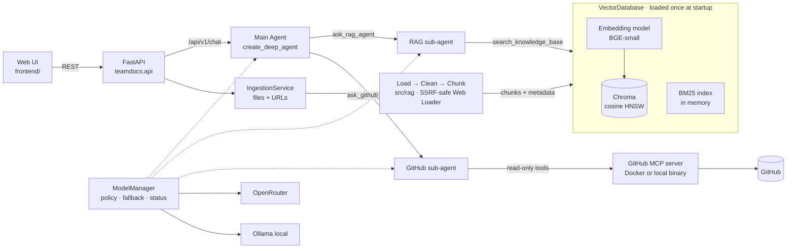

# TeamDocs AI

**AI-powered engineering knowledge assistant** — one assistant that answers from your documents and web pages (with
citations you can open and verify) and can inspect GitHub repositories, issues and pull requests. A **Main Agent**
(Deep Agents `create_deep_agent`) decides which specialist to call: the **RAG agent**, the **GitHub agent**, both, or neither.

> Status: backend, agents, UI and tests work end to end in the build sandbox with a scripted LLM; real OpenRouter/Ollama/GitHub
> calls were **not** exercised (see [What has and has not been verified](#what-has-and-has-not-been-verified)).
> Screenshots: _add real screenshots to `docs/screenshots/` after running the app — none are bundled._

## Problem

Engineering knowledge is scattered across PDFs, slide decks, READMEs and runbooks. Keyword search misses paraphrases,
and chat assistants answer confidently without showing where an answer came from. TeamDocs AI retrieves the relevant
passages from *your* documents, answers only from them, says so when the evidence isn't there, and links every
claim to its source passage.

## Features

* **Main Agent + two sub-agents.** Ask in plain language at `POST /api/v1/chat` (or the *Assistant* tab). The Main Agent
  routes to the RAG agent (documents + imported web pages), the GitHub agent (repository / code / issues / PRs), both for
  combined questions, or asks one clarifying question when the request is ambiguous. Every answer reports which agents
  ran, which model each used, their sources, and any failure.
* **Provider policy per agent.** OpenRouter when `OPENROUTER_API_KEY` is set, otherwise a local **Ollama** model. A *missing*
  key is never confused with a *rejected* key or an *outage*: in `auto` mode an outage/rejection triggers exactly one
  controlled retry on Ollama and is reported (`warnings`, `model.fallback`). Provider/model can be chosen in the UI.
* **GitHub credentials are independent** of the LLM provider (`GITHUB_PERSONAL_ACCESS_TOKEN`). A missing GitHub token never
  blocks RAG, and a missing OpenRouter key never blocks GitHub reads. The GitHub tools are read-only.
* **Web pages as knowledge.** Paste a URL in *Documents → Add page*; the existing Web Loader downloads it, it is cleaned,
  chunked, embedded and cited with its real URL. Re-importing unchanged content is a no-op; changed content replaces the old
  version. SSRF-protected (see [Security](#security-considerations)).
* Upload **PDF, DOCX, PPTX, Markdown, text and source-code** files (validated, size-limited).
* **Hybrid retrieval**: dense embeddings + BM25 fused with weighted Reciprocal Rank Fusion; dense-only and BM25-only modes.
* **Citations**: `[n]` markers map to real retrieved chunks (file/URL, page, section, excerpt, scores). Markers the model
  invents are stripped; if nothing supports an answer the app says so instead of guessing.
* **Incremental ingestion**: content-hash identity → unchanged files are never re-embedded, duplicates are skipped,
  edited files replace the old version, documents can be deleted or re-indexed.
* A **Settings** tab with the *real* state of OpenRouter, Ollama and GitHub (live "Check connections", "Reload .env").
* FastAPI backend with OpenAPI docs, health/readiness probes, consistent error format; static web UI (no build step); Docker Compose.

## Architecture



**Agents.** The Main Agent is built with `create_deep_agent`; Deep Agents' built-in file-system/shell/planning tools and the
default general-purpose sub-agent are switched off on purpose (it is exposed through a web API and only needs two typed
tools). Each sub-agent is a LangChain agent with its own tools and bounded run (tool-call limit, model-call limit,
recursion limit, timeout). Sub-agents return a structured result (`ok`, `answer`, `sources`/`github` refs, `error`, `model`,
`tool_calls`, `duration_ms`); a failed sub-agent is reported as a failure, never passed off as an answer. The RAG sub-agent
refuses to answer without retrieved passages. Repository and document text is untrusted data in every prompt.

**Model policy** (`LLM_PROVIDER`, per-agent `MAIN_/RAG_/GITHUB_LLM_PROVIDER`): `auto` = OpenRouter if a key exists else
Ollama; `openrouter` = OpenRouter only (missing key → explicit error); `ollama` = local only.

### RAG pipeline

1. **Ingest** – load (`pypdf`, Unstructured for DOCX/PPTX, text) → clean → chunk (header-aware for Markdown, recursive
   for text/PDF, code-aware for source; default 1200 chars, 200 overlap) → embed → store in Chroma.
   Each chunk keeps `filename`, `doc_id`, `page_number`, `section`, `chunk_index`.
2. **Retrieve** – the query is embedded once; dense top-`FETCH_K` and BM25 top-`FETCH_K` are fused by RRF
   (`score = Σ weight / (RRF_K + rank)`), identical-text chunks are collapsed, top-`TOP_K` returned.
3. **Generate** – one LLM call over numbered passages (`[1]…[n]`) with a grounding prompt. `NOT_FOUND` →
   "insufficient evidence" response. If retrieval is empty the LLM is not called.

### Hybrid retrieval

Dense search finds paraphrases ("how do we recover from failures" → *retry policy*); BM25 finds exact tokens
(`max_retries`, error codes, file names). BM25 uses token overlap to decide whether a chunk matched at all (BM25's IDF
can be ≤ 0 on small corpora). Weights: `DENSE_WEIGHT` (default 0.7) / `1 - DENSE_WEIGHT`.

### Embeddings and vector store

`BAAI/bge-small-en-v1.5` (normalized, cosine) via sentence-transformers, cached in `MODEL_CACHE_DIR`. Chroma persists to
`DATA_DIR/chroma`. Document and query embeddings use the same model by construction (single instance). If you change
`EMBEDDING_MODEL`, delete `DATA_DIR/chroma` and re-upload — vectors from different models are not comparable.

## Project structure

```
src/teamdocs/   FastAPI app: core/ (central settings, logging), services/ (ingestion, answering, container), api/ (routes, schemas)
src/rag/        Loaders, cleaners, chunkers, metadata extraction, VectorDatabase (hybrid retrieval), agent-style RagPipeline
src/devmind/    Agents: main_agent (Deep Agents), rag_agent, github_agent, tools, ModelManager (llm.py), GitHub MCP client
frontend/       index.html, styles.css, app.js (served by FastAPI at /)
tests/          pytest suite (no network, no model downloads)
scripts/        benchmark.py, smoke_test.py
evaluation/     DeepEval RAG evaluation (optional deps)
docs/AUDIT.md   Audit of the original code
```

## Technology

Python 3.12 · FastAPI/Uvicorn · LangChain · ChromaDB · rank-bm25 · sentence-transformers · pypdf/Unstructured ·
OpenRouter · Ollama · Deep Agents · GitHub MCP · vanilla JS frontend · pytest/ruff · Docker.

## Prerequisites

Python 3.11+ (**tested on 3.12.3**), ~3 GB disk for PyTorch + model, internet on first start (Hugging Face model
download). Optional, depending on what you want to use:

* **LLM:** an [OpenRouter](https://openrouter.ai) API key **or** a local [Ollama](https://ollama.com) with a
  *tool-calling* model (`ollama pull qwen2.5:7b-instruct-q4_K_M`; llama3.1 also works). The agents need tool calling.
* **GitHub agent:** a read-only GitHub token **and** either Docker (default) or a local `github-mcp-server` binary
  ([releases](https://github.com/github/github-mcp-server/releases), set `GITHUB_MCP_COMMAND`). The Docker image of this project already bundles the binary.

## Run locally (Windows PowerShell)

```powershell
python -m venv .venv
.\.venv\Scripts\Activate.ps1
python -m pip install --upgrade pip
pip install -r requirements.txt -r requirements-dev.txt
pip install -e . --no-deps
Copy-Item .env.example .env        # then edit .env (all keys optional, see Prerequisites)
python -m teamdocs.main
```

Open **http://127.0.0.1:8000** (UI) · **http://127.0.0.1:8000/docs** (OpenAPI). The first start downloads the embedding
model; `/ready` returns 503 until it is loaded.

## Run with Docker Compose

```powershell
Copy-Item .env.example .env
docker compose up --build -d
docker compose logs -f teamdocs
docker compose ps                         # STATUS shows (healthy) once /ready succeeds
Invoke-RestMethod http://localhost:8000/ready
docker compose stop                       # stop, data kept
docker compose up -d                      # start again
docker compose down                       # remove container, KEEP data
docker compose down -v                    # remove container AND all data
```

> In Docker, reach an Ollama running on the host with `OLLAMA_BASE_URL=http://host.docker.internal:11434`
> (the compose file maps `host.docker.internal`). The GitHub MCP server binary is bundled in the image
> (`GITHUB_MCP_COMMAND` is preset), so no Docker-in-Docker is needed. *The image build was not run in the sandbox.*

**Persistence:** the named volume `teamdocs-data` (`/data`) holds the Chroma index, uploaded originals and the downloaded
embedding model → survive restarts and `down`. They are lost with `down -v`. Container-internal files outside `/data`
are ephemeral.

## Configuration

All settings are environment variables / `.env` (full list with comments in `.env.example`). Key ones:

| Variable | Default | Meaning |
|---|---|---|
| `LLM_PROVIDER` | `auto` | `auto` (OpenRouter if key set, else Ollama) · `openrouter` · `ollama`. Per agent: `MAIN_/RAG_/GITHUB_LLM_PROVIDER`. |
| `OPENROUTER_API_KEY`, `OPENROUTER_MODEL` | – / `openrouter/free` | OpenRouter key and model id. |
| `OLLAMA_BASE_URL`, `OLLAMA_MODEL`, `OLLAMA_NUM_CTX` | `http://localhost:11434`, `qwen2.5:7b-instruct-q4_K_M`, 8192 | Local models. Must support tool calling. |
| `OLLAMA_FALLBACK_ON_ERROR` | `true` | One retry on Ollama when OpenRouter is down/rejects the key (`auto` mode only). |
| `GITHUB_PERSONAL_ACCESS_TOKEN` (alias `GITHUB_TOKEN`) | – | Read-only token. Independent of the LLM keys. |
| `GITHUB_MCP_COMMAND` | empty | Path to a local `github-mcp-server`; empty = run it with Docker. |
| `MAIN_AGENT_MAX_TOOL_CALLS`, `SUB_AGENT_MAX_TOOL_CALLS`, `AGENT_RECURSION_LIMIT`, `AGENT_TIMEOUT_SECONDS` | 6, 5, 30, 180 | Bounds on every agent run. |
| `WEB_FETCH_TIMEOUT_SECONDS`, `WEB_MAX_BYTES`, `WEB_MAX_REDIRECTS`, `WEB_ALLOW_PRIVATE_HOSTS` | 15, 5 MB, 5, `false` | URL import limits; keep private hosts blocked. |
| `EMBEDDING_MODEL` / `MODEL_CACHE_DIR` | `BAAI/bge-small-en-v1.5` / `data/models` | Embeddings and cache. |
| `RETRIEVAL_MODE`, `TOP_K`, `FETCH_K`, `RRF_K`, `DENSE_WEIGHT` | `hybrid`, 5, 20, 30, 0.7 | Retrieval tuning. |
| `MAX_UPLOAD_MB`, `CHUNK_SIZE`, `CHUNK_OVERLAP` | 25, 1200, 200 | Ingestion. |
| `METADATA_EXTRACTION` | `false` | LLM title/summary/keywords per document. |
| `PDF_BACKEND` | `pypdf` | `unstructured` = layout-aware, needs `unstructured[pdf]`, poppler, tesseract. |
| `FRONTEND_API_BASE_URL` | empty | Point the UI at a backend on another origin (also set `CORS_ORIGINS`). |

**One configuration source.** Everything is read by `teamdocs.core.config.Settings`. The `.env` next to the project is
found regardless of the working directory; a real environment variable wins over `.env`, but a *blank* one never hides the
value in `.env`; BOM/quotes/`Bearer ` prefixes/template placeholders are cleaned. Secrets are `SecretStr`: never logged, never returned by any endpoint.
After editing `.env` while the server runs, use **Settings → Reload .env** (`POST /api/v1/settings/reload`).

## API example

```powershell
curl.exe -F "file=@runbook.md" http://localhost:8000/api/v1/documents
curl.exe -X POST http://localhost:8000/api/v1/query -H "Content-Type: application/json" `
  -d '{\"question\":\"How are failed payments retried?\",\"top_k\":5}'
```

```json
{
  "answer": "Failed payment requests are retried up to 4 times with exponential backoff [1].",
  "sources": [{
    "index": 1, "filename": "runbook.md", "page": null, "section": "Payment Service Runbook > Retry policy",
    "excerpt": "Failed payment requests are retried up to 4 times using exponential backoff …",
    "cited": true, "score": 0.0323, "dense_score": 0.61, "bm25_score": 1.67,
    "doc_id": "2118299ae13b3a46", "chunk_id": "2118299ae13b3a46:00000"
  }],
  "insufficient_evidence": false, "generated": true, "mode": "hybrid", "model": "openrouter/free",
  "timings_ms": {"retrieval": 12.4, "generation": 1830.0, "total": 1842.6}
}
```

(Illustrative shape; values will differ.)

### Main Agent

```powershell
curl.exe -X POST http://localhost:8000/api/v1/chat -H "Content-Type: application/json" `
  -d '{\"message\":\"How does our retry policy work, and which open issues in owner/repo mention it?\"}'
```

```json
{
  "answer": "… exponential backoff [1] … issue #12 …",
  "agents_used": [
    {"agent": "rag", "ok": true, "tool_calls": ["search_knowledge_base[hybrid]"], "model": {"provider": "openrouter", "model": "openrouter/free", "fallback": false}, "duration_ms": 2310.4},
    {"agent": "github", "ok": false, "tool_calls": [], "error": {"code": "github_not_configured", "message": "GitHub is not configured: set GITHUB_PERSONAL_ACCESS_TOKEN in .env …"}, "duration_ms": 0.3}
  ],
  "sources": [{"index": 1, "filename": "https://example.com/docs/retry", "source_url": "https://example.com/docs/retry", "cited": true, "…": "…"}],
  "github": [], "warnings": ["The github agent failed: GitHub is not configured: …"],
  "model": {"provider": "openrouter", "model": "openrouter/free", "fallback": false}, "duration_ms": 5120.7
}
```

Endpoints: `GET /health`, `GET /ready`, `POST /api/v1/chat` (Main Agent), `POST /api/v1/query` (direct retrieval/answer),
`POST|GET /api/v1/documents`, `POST /api/v1/documents/url`, `DELETE /api/v1/documents/{doc_id}`,
`POST /api/v1/documents/{doc_id}/reindex`, `GET /api/v1/status[?check=true]`, `PUT /api/v1/settings/llm`, `POST /api/v1/settings/reload`.
Errors: `{"error": {"code": "...", "message": "..."}}` with 413/415/422/429/502/503/504 as appropriate
(e.g. `llm_unreachable`, `llm_auth`, `url_not_allowed`, `url_timeout`, `agent_timeout`).

## Tests and checks

```powershell
pytest                                   # 180 tests (173 run without extras, 7 need GITHUB_MCP_BINARY), no network/model download
$env:GITHUB_MCP_BINARY="C:\path\to\github-mcp-server.exe"; pytest tests/test_github_mcp_real.py   # real MCP server integration
ruff check src tests scripts
python scripts/smoke_test.py --base-url http://127.0.0.1:8000            # needs a running server + a provider
python scripts/smoke_test.py --base-url http://127.0.0.1:8000 --no-llm   # retrieval only
python scripts/benchmark.py                                              # real model; add --fake-embeddings to isolate DB overhead
```

What is real and what is replaced in the tests:

* **Real:** Chroma, BM25, loaders (PDF/DOCX/PPTX parsing), the FastAPI app, the Deep Agents graph, the LangChain sub-agents,
  tool/middleware limits, citation handling, the web loader against a **local HTTP server**, the provider status probes
  against **local HTTP servers**, and (with `GITHUB_MCP_BINARY`) the **official GitHub MCP server process** talking to a local fake GitHub REST API.
* **Replaced:** the *language model* (a scripted tool-calling double — no API key / Ollama in CI), the embedding model
  (deterministic fake), and, for most GitHub tests, the MCP session. So the suite proves wiring, routing mechanics,
  limits, fallback and error handling — **not** the routing quality of a real LLM.

## Performance decisions

* Embedding model, Chroma collection, BM25 index and LLM client are created **once** in the FastAPI lifespan, in a worker
  thread, and a warm-up embedding is run at startup. Tested: N queries → 1 resource build, 0 document re-embeddings,
  exactly 1 query embedding per request.
* Content-hash ingestion avoids re-embedding unchanged documents; embedding is batched by sentence-transformers.
* BM25 is rebuilt only after the collection changes (and eagerly after ingest), and filters are applied as a mask over
  the existing index. Blocking work runs in FastAPI's thread pool (`def` endpoints / `run_in_threadpool`).
* Single LLM call per question (retrieval first), bounded context (`MAX_CONTEXT_CHARS`), no query-result cache
  (avoids stale answers after document changes).
* Metadata LLM extraction: once per document instead of once per paragraph, and off by default.
* **Document list cache.** `/ready` (polled by the UI after every action) used to rescan all chunk metadata. Measured
  (6,000 chunks / 300 documents, sandbox): first call 181 ms → repeated calls 0.6 ms; the cache is keyed on a write counter
  plus the chunk count, so every upload/delete is visible immediately (regression-tested).
* **Chroma batch limit.** One call with more than 5,461 chunks crashed (`Batch size … greater than max batch size`); a large
  PDF or web page could trigger it. Writes are now batched (regression-tested with 5,600 chunks).
* **Agents:** one MCP connection per GitHub sub-agent run (not per call), models/clients cached by `ModelManager`,
  duplicate sub-agent calls suppressed, tool calls capped, chat endpoint is `async` (LLM/MCP awaited, blocking retrieval in worker threads).
* Measured (sandbox, **fake embeddings**, 2,000 synthetic chunks – i.e. Chroma/BM25/RRF overhead only, *not* real model
  latency): dense ≈ 1 ms, BM25 ≈ 3 ms, hybrid ≈ 5 ms median; startup 89 ms. Run `scripts/benchmark.py` on your machine for real-model numbers.

## What has and has not been verified

**Verified in the build sandbox** (Python 3.12.3, Linux, 1 CPU):

* 180 tests pass with `GITHUB_MCP_BINARY` set (173 + 7 skipped without it); `ruff` clean.
* **OpenRouter-key bug reproduced on the original code and fixed** (see *Troubleshooting*): the key was not seen when the server
  started from another directory, when an empty `OPENROUTER_API_KEY` existed in the environment, or when `.env` had a BOM; `devmind`
  and the API read configuration separately and disagreed. Tests cover each case.
* The **official GitHub MCP server v2.2.0** (real process, stdio) with our client: tool listing (only read-only tools exposed),
  file and directory reads, error results, token sent as a Bearer header, the GitHub sub-agent end to end. This found three real
  bugs in the old code, now fixed: `mcp` 2.x renamed `isError` to `is_error` (errors were treated as file content), files in
  sub-directories were never saved (missing `mkdir`), and the status line of a file read was written into the downloaded file.
* URL import against a real local HTTP server (redirects, timeout, size cap, content type, 404, empty page, loop, dedup, replace,
  delete, re-index) and the SSRF rules (loopback, private, link-local/cloud-metadata, CGNAT, hostname→private, redirect→private); a
  mutation check (SSRF guard disabled) makes those tests fail.
* The frontend driven in jsdom against a live backend: assistant answer with agent chips/sources/GitHub refs, provider status,
  settings cards with a live check, provider selection, invalid-URL error.

**Not verified (be aware):**

* Any real **OpenRouter** call, any real **Ollama** model, so: real routing quality of the Main Agent, tool-calling reliability of
  small local models, answer quality, real latency. (openrouter.ai and Hugging Face were unreachable from the sandbox.)
* The GitHub agent against **real github.com with a valid token** (only a fake token → real `401 Bad credentials` was observed,
  and a local fake GitHub API); GraphQL-backed tools such as `list_issues` / PR reads were therefore not exercised end to end.
* The real `BAAI/bge-small-en-v1.5` model / torch runtime, the Docker image build and run, Windows execution, a real browser/visual check, `PDF_BACKEND=unstructured`.

## Known limitations

* Transitive dependency versions float (only direct dependencies are pinned); no lockfile was generated.
* English documents only (loaders/embedding model are English-oriented); scanned PDFs without text layer are rejected.
* **Agent quality depends on the model.** Small local models can route poorly or ignore tools; the Main Agent needs a model with
  reliable tool calling. The Deep Agents prompt is long: use `OLLAMA_NUM_CTX` ≥ 8192.
* **Every GitHub operation needs a token** (the MCP server does not start without one). Unauthenticated read of public repositories
  would need the REST API and is not implemented.
* GitHub is read-only by design (no write tools are exposed). Large files are truncated in tool output; at most `SUB_AGENT_MAX_TOOL_CALLS` calls per question.
* URL import: JavaScript-rendered pages yield no text; PDFs/binaries at a URL are rejected; DNS-rebinding between the SSRF check and
  the connection is not prevented (see Security).
* The old "index a whole repository into the vector store" flow (`devmind/services/qa_service.py`) is **legacy and not wired**
  anymore; repository questions are answered live by the GitHub agent. Porting repository indexing onto the shared store is a possible follow-up.
* The chat endpoint is stateless (the UI sends the last turns); no streaming responses.
* Single process, no authentication or per-user isolation: put it behind a reverse proxy/auth before exposing it.
* BM25 index is in memory and rebuilt on change — fine for thousands of chunks, not millions.

## Troubleshooting

* **"OpenRouter key not configured" although you set it** → fixed causes: `.env` is now located relative to the project (not the
  working directory), blank environment variables no longer shadow `.env`, a BOM/quotes/`Bearer ` prefix are tolerated, one `Settings` object feeds every component, and
  **Settings → Reload .env** applies a changed key without restart. Open **Settings → Check connections** to see the real state
  (key present? where from? accepted by OpenRouter?). Template placeholders such as `your_key` count as *not set*.
* `llm_auth` → OpenRouter rejected the key (typo/expired). In `auto` mode the request is retried once on Ollama and you get a warning.
* `llm_unreachable` for Ollama → start it (`ollama serve`), check `OLLAMA_BASE_URL`; `ollama pull <model>` if the model is missing.
* `llm_no_tool_support` → pick a tool-capable Ollama model (qwen2.5, llama3.1).
* `github_not_configured` / `github_auth` / `github_unavailable` → set the token / use a valid token / install Docker or set `GITHUB_MCP_COMMAND`.
* `url_not_allowed` → the URL points to a private/internal address (by design). `url_fetch_failed` → HTTP error, non-HTML type, too large or too many redirects.
* `/ready` is 503 → open `/ready` or the logs: usually the embedding model could not be downloaded (offline/proxy).
* `.docx` fails on Windows with a `magic` error → `pip install python-magic-bin`.
* Changed `EMBEDDING_MODEL` → delete `DATA_DIR/chroma` and re-upload.

## Security considerations

Uploads: extension allow-list, size cap, magic-byte check for PDF/DOCX/PPTX, sanitized filenames (no path components),
temp files removed, originals stored under hash names. Retrieved text, web pages and GitHub content are treated as untrusted
data in every prompt; the UI renders all text with `textContent` (links only for `http(s)`).

**URL import (SSRF):** only `http`/`https`, no embedded credentials; the host must resolve **only to globally routable addresses**
(loopback, private, link-local incl. cloud metadata `169.254.169.254`, CGNAT, multicast, reserved are refused); **every redirect hop
is re-validated** and hops are limited; the response is size-capped while streaming and only text/HTML types are accepted; proxy
environment variables are ignored. *Residual risk:* DNS rebinding between check and connect; run the service without access to
internal networks if that matters to you.

**Secrets:** `OPENROUTER_API_KEY` and the GitHub token are `SecretStr`, passed to the GitHub MCP process through its environment
only, never logged and never returned by any endpoint (tested). **Agents:** Deep Agents' file-system/shell tools are removed, GitHub
tools are read-only and allow-listed, argument validation on owner/repo/path, bounded tool calls and run time.
Remaining risks: no authentication/rate limiting, prompt injection can still influence answers, document/web/GitHub text is sent to the LLM
provider, and Unstructured parsers process untrusted files in-process.

## Future improvements

Authentication and multi-tenant collections · reranking cross-encoder · streaming answers · OCR for scans · persisted BM25 ·
lockfile + CI · repository indexing on the shared store · unauthenticated public-repo reads via the GitHub REST API ·
evaluation set for Main-Agent routing with a real model.

## License

No license file was present in the received project; none has been added. Choose one before publishing.
