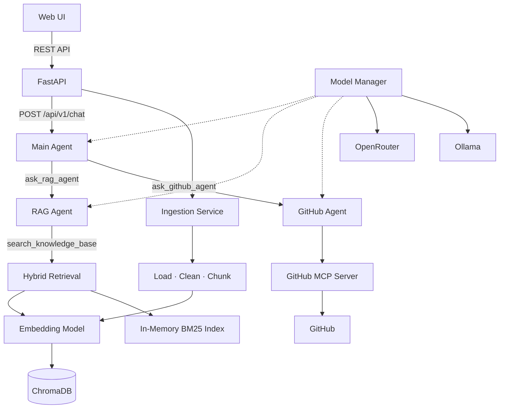
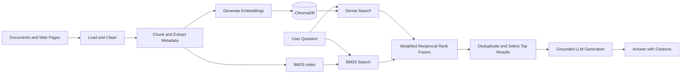

# 🤖 TeamDocs AI

**AI-Powered Engineering Knowledge Assistant**


TeamDocs AI is an AI-powered knowledge assistant that answers questions using documents and web pages with verifiable citations, and explores GitHub repositories, issues, and pull requests through read-only tools.

A **Main Agent**, built with Deep Agents' `create_deep_agent`, coordinates two specialized agents to determine whether a request requires knowledge retrieval, GitHub inspection, both, or clarification.

## 📑 Table of Contents

- [Why TeamDocs AI?](#-why-teamdocs-ai)
- [Features](#-features)
- [Architecture](#-architecture)
- [RAG Pipeline](#-rag-pipeline)
- [Technology Stack](#-technology-stack)
- [Project Structure](#-project-structure)
- [Getting Started](#-getting-started)
- [Configuration](#️-configuration)
- [API Reference](#-api-reference)
- [Testing and Quality](#-testing-and-quality)
- [Performance](#-performance)
- [Verification Status](#-verification-status)
- [Known Limitations](#️-known-limitations)
- [Troubleshooting](#️-troubleshooting)
- [Security](#-security)
- [Future Improvements](#️-future-improvements)
- [License](#-license)

## 🎯 Why TeamDocs AI?

Engineering knowledge is often distributed across PDFs, slide decks, READMEs, runbooks, and source repositories. Traditional keyword search can miss paraphrased questions, while a language model may produce confident answers without sufficient evidence.

TeamDocs AI combines retrieval-augmented generation (RAG) with agent-based orchestration to:

- Retrieve relevant passages from indexed documents and imported web pages.
- Generate answers grounded in retrieved evidence.
- Link claims to source passages and expose retrieval metadata.
- Acknowledge insufficient evidence instead of guessing.
- Inspect GitHub repositories, code, issues, and pull requests when requested.

## ✨ Features

- **🧠 Agent orchestration:** A Main Agent coordinates the RAG and GitHub agents through `POST /api/v1/chat` or the web interface's Assistant tab.
- **🔎 Flexible retrieval:** Supports dense retrieval, BM25, and hybrid search.
- **🔗 Verifiable citations:** Returns source references with filenames or URLs, page numbers, sections, excerpts, and retrieval scores. Unsupported citation markers generated by the model are removed.
- **🐙 GitHub integration:** Reads repository content, code, issues, and pull requests through allow-listed, read-only GitHub tools.
- **🌐 Web-page ingestion:** Imports pages through **Documents → Add page**, processes their content, and preserves the original URL for citations.
- **📄 Multiple file formats:** Supports PDF, DOCX, PPTX, Markdown, text, and source-code files.
- **♻️ Incremental ingestion:** Uses content hashes to skip unchanged documents, replace edited versions, and support deletion and re-indexing.
- **🔌 Flexible LLM providers:** Supports OpenRouter and local Ollama models, including configurable provider selection and controlled fallback behavior.
- **⚙️ Connection management:** Checks OpenRouter, Ollama, and GitHub connectivity through the Settings tab.
- **🚀 API and deployment support:** Provides FastAPI endpoints, OpenAPI documentation, health and readiness checks, structured errors, and Docker Compose configuration.

## 🏗️ Architecture



### 🧩 Agent Design

The application contains three agents:

| Agent | Responsibility |
|---|---|
| Main Agent | Coordinates specialist agents and determines which tools to invoke. |
| RAG Agent | Retrieves relevant knowledge and generates evidence-grounded answers. |
| GitHub Agent | Inspects GitHub repositories, code, issues, and pull requests using read-only tools. |

The Main Agent uses Deep Agents' `create_deep_agent`. Its built-in filesystem, shell, planning tools, and default general-purpose sub-agent are disabled because the application requires only two typed tools exposed through its web API.

Each specialist is a LangChain agent with bounded execution, including tool-call limits, model-call limits, recursion limits, and timeouts.

Sub-agents return structured results that can include `ok`, `answer`, `sources` or GitHub references, `error`, `model`, `tool_calls`, and `duration_ms`.

Failures are reported as failures rather than presented as successful answers. The RAG agent refuses to answer without retrieved passages, and repository and document content is treated as untrusted input in prompts.

### 🔀 LLM Provider Policy

Configure the provider globally with `LLM_PROVIDER` or independently for each agent using `MAIN_LLM_PROVIDER`, `RAG_LLM_PROVIDER`, and `GITHUB_LLM_PROVIDER`.

| Provider mode | Behavior |
|---|---|
| `auto` | Uses OpenRouter when an API key is configured; otherwise uses Ollama. |
| `openrouter` | Uses OpenRouter exclusively. A missing API key produces an explicit error. |
| `ollama` | Uses a local Ollama model exclusively. |

In `auto` mode, an OpenRouter authentication failure or provider outage triggers one controlled retry using Ollama. The fallback is reported in the response.

GitHub credentials are independent of LLM credentials. Missing GitHub credentials do not block RAG requests, and a missing OpenRouter API key does not block GitHub reads.

## 🔍 RAG Pipeline

The retrieval-augmented generation pipeline consists of three stages.



### 1. Ingestion

Documents are loaded, cleaned, split into chunks, embedded, and stored in ChromaDB. BM25 maintains an in-memory index for lexical retrieval.

Supported processing strategies include:

- `pypdf` for PDF processing.
- Unstructured for DOCX and PPTX processing.
- Header-aware chunking for Markdown.
- Recursive chunking for text and PDF content.
- Code-aware chunking for source files.

Default chunk settings:

| Setting | Default |
|---|---:|
| `CHUNK_SIZE` | 1,200 characters |
| `CHUNK_OVERLAP` | 200 characters |

Each chunk retains metadata such as `filename`, `doc_id`, `page_number`, `section`, and `chunk_index`.

### 2. Retrieval

The system combines semantic similarity with lexical matching:

- **Dense retrieval:** Finds semantically related passages, including paraphrases.
- **BM25 retrieval:** Matches terms such as `max_retries`, filenames, and error codes.
- **Weighted Reciprocal Rank Fusion (RRF):** Combines the rankings from both retrieval methods.
- **Deduplication:** Collapses chunks containing identical text before returning the final results.

The fusion score is calculated as:

\[
\operatorname{score}(d)=\sum_i\frac{w_i}{\operatorname{RRF\_K}+\operatorname{rank}_i(d)}
\]

Default retrieval parameters:

| Parameter | Default |
|---|---:|
| `RETRIEVAL_MODE` | `hybrid` |
| `DENSE_WEIGHT` | `0.7` |
| `TOP_K` | `5` |
| `FETCH_K` | `20` |
| `RRF_K` | `30` |

BM25 uses token overlap to determine whether a chunk matched at all, because its inverse document frequency can be zero or negative on small corpora.

### 3. Generation and Citations

Retrieved passages are numbered and sent to the configured LLM with a grounding prompt. The application does not call the LLM when retrieval returns no results and reports insufficient evidence when the available context does not support an answer.

Citations can include:

- Source filename or original URL.
- Page number and section.
- Text excerpt.
- Retrieval score and available dense/BM25 scores.
- Document and chunk identifiers.

### 🧮 Embeddings and Vector Store

| Component | Implementation |
|---|---|
| Embedding model | `BAAI/bge-small-en-v1.5` |
| Embedding library | Sentence Transformers |
| Vector database | ChromaDB |
| Distance metric | Cosine |
| Vector index | HNSW |
| Lexical index | In-memory BM25 |
| Model cache | `MODEL_CACHE_DIR` |
| Persistent vector storage | `DATA_DIR/chroma` |

The embedding model uses normalized embeddings, and document and query embeddings share the same model instance.

**Changing the embedding model:** If `EMBEDDING_MODEL` changes, delete `DATA_DIR/chroma` and re-upload the documents. Vectors produced by different embedding models are not directly comparable.

## 🧰 Technology Stack

| Category | Technologies |
|---|---|
| Language | Python 3.12 |
| Backend | FastAPI, Uvicorn |
| Agent orchestration | LangChain, Deep Agents |
| Retrieval | Sentence Transformers, `rank-bm25`, Reciprocal Rank Fusion |
| Vector database | ChromaDB |
| Document processing | `pypdf`, Unstructured |
| LLM providers | OpenRouter, Ollama |
| GitHub integration | GitHub MCP |
| Frontend | HTML, CSS, vanilla JavaScript |
| Testing and quality | pytest, Ruff |
| Deployment | Docker, Docker Compose |

## 📂 Project Structure

```text
src/
├── teamdocs/       # FastAPI application, settings, logging, services,
│                   # ingestion, answering, API routes, and schemas
├── rag/            # Loaders, cleaners, chunkers, metadata extraction,
│                   # VectorDatabase, hybrid retrieval, and RagPipeline
└── devmind/        # Main Agent, RAG Agent, GitHub Agent, tools,
                    # ModelManager, and GitHub MCP client

frontend/           # Static web interface: HTML, CSS, and JavaScript
tests/              # Pytest suite
scripts/            # Benchmark and smoke-test scripts
evaluation/         # Optional DeepEval RAG evaluation
docs/AUDIT.md       # Audit of the original code
```

## 🚀 Getting Started

### Prerequisites

- Python 3.11 or later; tested with Python 3.12.3.
- Approximately 3 GB of disk space for PyTorch and the embedding model.
- Internet access on first startup to download the Hugging Face embedding model.
- An LLM provider, depending on intended usage.
- Docker or a local GitHub MCP server binary if using the GitHub agent.

### 1. Configure an LLM Provider

Choose one of the supported options.

**OpenRouter**

Obtain an API key from [OpenRouter](https://openrouter.ai) and configure `OPENROUTER_API_KEY` in your `.env` file.

**Ollama**

Install [Ollama](https://ollama.com), then pull a tool-calling model:

```bash
ollama pull qwen2.5:7b-instruct-q4_K_M
```

Llama 3.1 is also supported.

### 2. Configure GitHub Integration (Optional)

The GitHub agent requires a read-only GitHub token and either Docker or a local `github-mcp-server` binary.

- [GitHub MCP Server Releases](https://github.com/github/github-mcp-server/releases)
- Set `GITHUB_MCP_COMMAND` when using a local binary.

The project's Docker image bundles the GitHub MCP server binary, so a separate Docker-in-Docker setup is not required.

### 3. Run Locally on Windows

Open PowerShell in the project root:

```powershell
python -m venv .venv
.\.venv\Scripts\Activate.ps1

python -m pip install --upgrade pip
pip install -r requirements.txt -r requirements-dev.txt
pip install -e . --no-deps

Copy-Item .env.example .env
# Edit .env as needed

python -m teamdocs.main
```

Once the server starts, open:

| Resource | URL |
|---|---|
| Web UI | http://127.0.0.1:8000 |
| OpenAPI documentation | http://127.0.0.1:8000/docs |
| Readiness endpoint | http://127.0.0.1:8000/ready |

The first startup downloads the embedding model. The readiness endpoint returns `503` until the model has loaded.

### 4. Run with Docker Compose

Create the environment file and start the application:

```powershell
Copy-Item .env.example .env

docker compose up --build -d
docker compose logs -f teamdocs
docker compose ps

Invoke-RestMethod http://localhost:8000/ready
```

Useful lifecycle commands:

```powershell
# Stop the service while preserving data
docker compose stop

# Start it again
docker compose up -d

# Remove containers while preserving named-volume data
docker compose down

# Remove containers and all named-volume data
docker compose down -v
```

For an Ollama instance running on the host, configure:

```env
OLLAMA_BASE_URL=http://host.docker.internal:11434
```

The Compose configuration maps `host.docker.internal`.

> **Verification note:** The Docker image build and runtime were not verified in the build sandbox.

### 💾 Data Persistence

The named volume `teamdocs-data`, mounted at `/data`, stores:

- The ChromaDB index.
- Uploaded original files.
- The downloaded embedding model.

These files survive restarts and `docker compose down`. Running `docker compose down -v` removes the named-volume data. Files stored in the container outside `/data` are ephemeral.

## ⚙️ Configuration

Application settings are managed through environment variables and `.env`. See `.env.example` for the complete configuration list.

### Environment Variables

| Variable | Default | Description |
|---|---|---|
| `LLM_PROVIDER` | `auto` | Selects `auto`, `openrouter`, or `ollama`. Agent-specific overrides are available. |
| `OPENROUTER_API_KEY` | — | OpenRouter API key. |
| `OPENROUTER_MODEL` | `openrouter/free` | OpenRouter model identifier. |
| `OLLAMA_BASE_URL` | `http://localhost:11434` | Ollama server URL. |
| `OLLAMA_MODEL` | `qwen2.5:7b-instruct-q4_K_M` | Local model; tool-calling support is required. |
| `OLLAMA_NUM_CTX` | `8192` | Ollama context size. |
| `OLLAMA_FALLBACK_ON_ERROR` | `true` | Enables one Ollama retry for OpenRouter errors in `auto` mode. |
| `GITHUB_PERSONAL_ACCESS_TOKEN` | — | GitHub token. `GITHUB_TOKEN` is an alias. |
| `GITHUB_MCP_COMMAND` | Empty | Local GitHub MCP server path. Empty means Docker is used. |
| `MAIN_AGENT_MAX_TOOL_CALLS` | `6` | Main Agent tool-call limit. |
| `SUB_AGENT_MAX_TOOL_CALLS` | `5` | Sub-agent tool-call limit. |
| `AGENT_RECURSION_LIMIT` | `30` | Agent recursion limit. |
| `AGENT_TIMEOUT_SECONDS` | `180` | Agent execution timeout. |
| `WEB_FETCH_TIMEOUT_SECONDS` | `15` | Web import timeout. |
| `WEB_MAX_BYTES` | `5 MB` | Maximum web response size. |
| `WEB_MAX_REDIRECTS` | `5` | Maximum redirects during web import. |
| `WEB_ALLOW_PRIVATE_HOSTS` | `false` | Controls access to private hosts. Keep disabled. |
| `EMBEDDING_MODEL` | `BAAI/bge-small-en-v1.5` | Embedding model identifier. |
| `MODEL_CACHE_DIR` | `data/models` | Embedding model cache directory. |
| `RETRIEVAL_MODE` | `hybrid` | Retrieval mode. |
| `TOP_K` | `5` | Number of final retrieved chunks. |
| `FETCH_K` | `20` | Number of candidates retrieved per method. |
| `RRF_K` | `30` | Reciprocal Rank Fusion parameter. |
| `DENSE_WEIGHT` | `0.7` | Dense retrieval weight. |
| `MAX_UPLOAD_MB` | `25` | Maximum upload size in MB. |
| `CHUNK_SIZE` | `1200` | Chunk size in characters. |
| `CHUNK_OVERLAP` | `200` | Chunk overlap in characters. |
| `METADATA_EXTRACTION` | `false` | Enables LLM-based title, summary, and keyword extraction. |
| `PDF_BACKEND` | `pypdf` | Use `unstructured` for layout-aware PDF processing with additional dependencies. |
| `FRONTEND_API_BASE_URL` | Empty | Optional API base URL for a backend on another origin. Configure `CORS_ORIGINS` as well. |

Agent-specific provider overrides:

- `MAIN_LLM_PROVIDER`
- `RAG_LLM_PROVIDER`
- `GITHUB_LLM_PROVIDER`

### Configuration Behavior

All settings are read through `teamdocs.core.config.Settings`.

- The `.env` file is located independently of the current working directory.
- Real environment variables take precedence over `.env`.
- Blank environment variables do not hide values defined in `.env`.
- BOMs, quotes, `Bearer ` prefixes, and template placeholders are handled.
- Secrets use `SecretStr` and are not logged or returned by endpoints.

After editing `.env` while the server is running, use **Settings → Reload .env**, which calls `POST /api/v1/settings/reload`.

## 🔌 API Reference

The application exposes endpoints for direct RAG queries, agent orchestration, document management, status checks, and configuration updates.

### Direct RAG Query

Upload a document:

```powershell
curl.exe -F "file=@runbook.md" http://localhost:8000/api/v1/documents
```

Ask a question:

```powershell
curl.exe -X POST http://localhost:8000/api/v1/query `
  -H "Content-Type: application/json" `
  -d '{\"question\":\"How are failed payments retried?\",\"top_k\":5}'
```

Illustrative response:

```json
{
  "answer": "Failed payment requests are retried up to 4 times with exponential backoff [1].",
  "sources": [
    {
      "index": 1,
      "filename": "runbook.md",
      "page": null,
      "section": "Payment Service Runbook > Retry policy",
      "excerpt": "Failed payment requests are retried up to 4 times using exponential backoff …",
      "cited": true,
      "score": 0.0323,
      "dense_score": 0.61,
      "bm25_score": 1.67,
      "doc_id": "2118299ae13b3a46",
      "chunk_id": "2118299ae13b3a46:00000"
    }
  ],
  "insufficient_evidence": false,
  "generated": true,
  "mode": "hybrid",
  "model": "openrouter/free",
  "timings_ms": {
    "retrieval": 12.4,
    "generation": 1830.0,
    "total": 1842.6
  }
}
```

*This example illustrates the response structure; actual values will vary.*

### Main Agent Chat

The Main Agent can coordinate document retrieval and GitHub inspection in one request.

```powershell
curl.exe -X POST http://localhost:8000/api/v1/chat `
  -H "Content-Type: application/json" `
  -d '{\"message\":\"How does our retry policy work, and which open issues in owner/repo mention it?\"}'
```

The response can include:

- The final answer.
- `agents_used`, including each agent's status, model, tool calls, and duration.
- Document and web citations in `sources`.
- GitHub references in `github`.
- Warnings and structured error information.
- Model provider and fallback details.

### Available Endpoints

| Method | Endpoint | Purpose |
|---|---|---|
| `GET` | `/health` | Health check. |
| `GET` | `/ready` | Readiness check. |
| `POST` | `/api/v1/chat` | Main Agent chat. |
| `POST` | `/api/v1/query` | Direct retrieval and answer generation. |
| `POST`, `GET` | `/api/v1/documents` | Upload and list documents. |
| `POST` | `/api/v1/documents/url` | Import a web page. |
| `DELETE` | `/api/v1/documents/{doc_id}` | Delete a document. |
| `POST` | `/api/v1/documents/{doc_id}/reindex` | Re-index a document. |
| `GET` | `/api/v1/status` | Provider and service status; supports `?check=true`. |
| `PUT` | `/api/v1/settings/llm` | Update LLM settings. |
| `POST` | `/api/v1/settings/reload` | Reload `.env` settings. |

### Error Responses

Errors use a consistent structure:

```json
{
  "error": {
    "code": "...",
    "message": "..."
  }
}
```

Relevant HTTP status codes include `413`, `415`, `422`, `429`, `502`, `503`, and `504`, depending on the error.

## 🧪 Testing and Quality

### Run the Test Suite

```powershell
pytest
```

The documented build-sandbox configuration contains 180 tests. Seven tests require `GITHUB_MCP_BINARY`; without that binary, 173 tests run.

### Run Ruff

```powershell
ruff check src tests scripts
```

### Run Smoke Tests

Against a running application with an LLM provider:

```powershell
python scripts/smoke_test.py --base-url http://127.0.0.1:8000
```

For retrieval-only checks without LLM generation:

```powershell
python scripts/smoke_test.py --base-url http://127.0.0.1:8000 --no-llm
```

### Run the Benchmark

```powershell
python scripts/benchmark.py
```

The benchmark uses a real model by default. Add `--fake-embeddings` to isolate database and retrieval overhead.

### Test Coverage and Boundaries

**Real components exercised:**

- ChromaDB and BM25.
- PDF, DOCX, and PPTX parsing.
- FastAPI application.
- Deep Agents graph and LangChain sub-agents.
- Tool and middleware limits.
- Citation handling.
- Web loader against a local HTTP server.
- Provider status probes against local HTTP servers.
- The official GitHub MCP server process, when `GITHUB_MCP_BINARY` is configured, against a local fake GitHub REST API.

**Replaced components:**

- The language model is a scripted tool-calling double.
- The embedding model is deterministic and fake.
- Most GitHub tests replace the MCP session.

The test suite validates application wiring, routing mechanics, execution limits, fallback behavior, and error handling. It does **not** establish the routing quality of a real LLM.

## ⚡ Performance

### Implementation Decisions

- The embedding model, ChromaDB collection, BM25 index, and LLM client are initialized once during the FastAPI lifespan.
- A warm-up embedding runs at startup.
- Content hashes prevent unchanged documents from being re-embedded.
- Sentence Transformers batches document embeddings.
- BM25 is rebuilt only when the collection changes.
- Blocking operations run through FastAPI's thread pool.
- Retrieval precedes generation, with one LLM call per question.
- Context is bounded by `MAX_CONTEXT_CHARS`.
- Query-result caching is not used, avoiding stale answers after document changes.
- Metadata extraction runs once per document and is disabled by default.
- Chroma writes are batched to avoid failures when processing large document collections.

### Measured Results

| Scenario | Measurement |
|---|---:|
| Document-list cache, first call | 181 ms |
| Document-list cache, repeated call | 0.6 ms |
| Dense retrieval benchmark, median | Approximately 1 ms |
| BM25 retrieval benchmark, median | Approximately 3 ms |
| Hybrid retrieval benchmark, median | Approximately 5 ms |
| Benchmark startup | 89 ms |

These measurements were obtained in the sandbox. Retrieval benchmarks used fake embeddings and 2,000 synthetic chunks. They measure ChromaDB, BM25, and RRF overhead rather than real model inference latency.

## 🔬 Verification Status

### ✅ Verified in the Build Sandbox

**Environment:** Python 3.12.3, Linux, one CPU.

- 180 tests pass when `GITHUB_MCP_BINARY` is configured; 173 run without it.
- Ruff checks pass.
- Configuration issues involving working directories, blank environment variables, and `.env` BOMs were reproduced and fixed.
- The official GitHub MCP Server v2.2.0 was exercised as a real stdio process, including tool listing, file and directory reads, error results, and Bearer-token handling.
- URL import was tested against a local HTTP server, including redirects, timeouts, size limits, content types, errors, deduplication, replacement, deletion, and re-indexing.
- SSRF protections were tested against loopback, private, link-local, cloud-metadata, CGNAT, hostname-resolution, and redirect scenarios.
- The frontend was tested with jsdom against a live backend for assistant responses, source references, provider status, settings, provider selection, and invalid-URL errors.

### ⚠️ Not Verified

- Real OpenRouter API calls.
- Real Ollama model execution and tool-calling reliability.
- Real LLM routing, answer quality, and model latency.
- GitHub agent operation against `github.com` with a valid token. A fake token produced a real `401 Bad credentials` response; local tests used a fake GitHub REST API.
- The actual `BAAI/bge-small-en-v1.5` model and PyTorch runtime.
- Docker image build and execution.
- Windows execution.
- Real-browser visual testing.
- The `PDF_BACKEND=unstructured` configuration.

These boundaries should be considered when evaluating the project's current readiness.

## ⚠️ Known Limitations

- Only direct dependency versions are pinned; transitive dependencies are not locked.
- Document processing and the embedding model are English-oriented.
- Scanned PDFs without a text layer are rejected.
- Agent quality depends on the selected model. Small local models may route requests poorly or fail to use tools reliably.
- The Main Agent uses a long prompt; `OLLAMA_NUM_CTX` should be at least `8192`.
- Every GitHub operation requires a token. Unauthenticated reads of public repositories through the REST API are not implemented.
- GitHub integration is read-only.
- Large GitHub files may be truncated in tool output.
- GitHub tool calls are bounded by `SUB_AGENT_MAX_TOOL_CALLS`.
- JavaScript-rendered web pages may yield no text.
- PDFs and binary files supplied as URLs are rejected.
- DNS rebinding between SSRF validation and the actual connection is not prevented.
- The previous repository-indexing flow in `devmind/services/qa_service.py` is legacy and is no longer wired into the application. Repository questions are handled live by the GitHub agent.
- Chat is stateless; the UI sends recent turns.
- Streaming responses are not implemented.
- The application runs as a single process and has no authentication or per-user isolation.
- BM25 is held in memory and rebuilt when the collection changes, making it better suited to thousands of chunks than millions.

## 🛠️ Troubleshooting

| Problem | Suggested action |
|---|---|
| OpenRouter key appears missing | Check `.env`, environment-variable precedence, template placeholders, and **Settings → Check connections**. Use **Settings → Reload .env** after editing. |
| `llm_auth` | OpenRouter rejected the key. Check for a typo or expired key. In `auto` mode, one Ollama retry is attempted. |
| `llm_unreachable` for Ollama | Start Ollama with `ollama serve` and check `OLLAMA_BASE_URL`. Pull the configured model if needed. |
| `llm_no_tool_support` | Select an Ollama model with tool-calling support, such as Qwen 2.5 or Llama 3.1. |
| `github_not_configured` | Configure `GITHUB_PERSONAL_ACCESS_TOKEN`. |
| `github_auth` | Verify the GitHub token. |
| `github_unavailable` | Check Docker or configure `GITHUB_MCP_COMMAND`. |
| `url_not_allowed` | The URL points to a private or internal address, which is blocked by design. |
| `url_fetch_failed` | Check the HTTP response, content type, response size, and redirect count. |
| `/ready` returns `503` | Inspect the readiness response and logs. The embedding model may not have downloaded successfully. |
| DOCX parsing fails on Windows with a `magic` error | Install `python-magic-bin`. |
| Embedding model changed | Delete `DATA_DIR/chroma` and re-upload the documents. |

## 🔒 Security

### File Uploads

- File extensions are allow-listed.
- Upload size is limited.
- PDF, DOCX, and PPTX files are checked using magic bytes.
- Filenames are sanitized to remove path components.
- Temporary files are removed.
- Original files are stored under hash-based names.

### Web Import and SSRF Protection

Only `http` and `https` URLs are accepted, and embedded credentials are disallowed.

The destination host must resolve exclusively to globally routable addresses. Loopback, private, link-local, cloud-metadata, CGNAT, multicast, and reserved addresses are blocked.

Every redirect is revalidated, redirect counts are limited, response sizes are capped during streaming, and only text or HTML content types are accepted. Proxy environment variables are ignored.

**Residual risk:** DNS rebinding between validation and connection is not prevented. If this risk matters to your deployment, run the service without access to internal networks.

### Secrets and Agent Controls

- OpenRouter and GitHub tokens use `SecretStr`.
- Secrets are not logged or returned by endpoints.
- The GitHub MCP process receives its token through its environment.
- Deep Agents' filesystem and shell tools are removed.
- GitHub tools are read-only and allow-listed.
- Owner, repository, and path arguments are validated.
- Tool calls and execution time are bounded.

**Remaining security considerations:**

- Authentication and rate limiting are not implemented.
- Prompt injection may influence answers.
- Document, web-page, and GitHub content may be sent to the configured LLM provider.
- Untrusted files are processed in-process through Unstructured.

## 🗺️ Future Improvements

Potential areas for further development include:

- Authentication and multi-tenant collections.
- Cross-encoder reranking.
- Streaming answers.
- OCR support for scanned documents.
- Persistent BM25 index.
- Dependency lockfile and CI.
- Repository indexing through the shared vector store.
- Unauthenticated public-repository reads through the GitHub REST API.
- A real-model evaluation set for Main Agent routing.

## 📄 License

No license file was present in the received project, and none has been added. Choose a license before publishing the repository.
