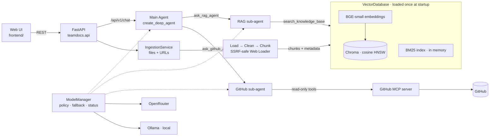
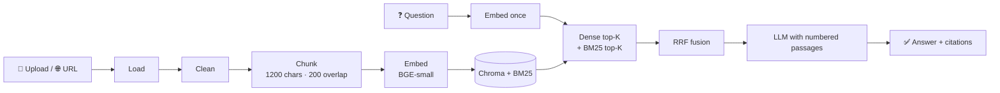

<div align="center">

# 📚 TeamDocs AI

### Your team's knowledge, one question away.

**An AI engineering assistant that answers from your documents with verifiable citations, and inspects your GitHub repositories, issues and pull requests.**

[](#quick-start)
[](#api)
[](#agents)
[](#rag)
[](#docker)

[**Problem**](#problem) · [**Solution**](#solution) · [**Architecture**](#architecture) · [**Agents**](#agents) · [**RAG**](#rag) · [**Quick start**](#quick-start) · [**API**](#api) · [**Security**](#security) · [**Roadmap**](#roadmap)

</div>

<details>
<summary><b>📑 Table of contents</b></summary>

1. [At a glance](#at-a-glance)
2. [The Problem](#problem)
3. [The Solution](#solution)
4. [See it in action](#demo)
5. [Architecture](#architecture)
6. [Meet the Agents](#agents)
7. [The RAG Pipeline](#rag)
8. [Quick Start](#quick-start)
   - [Run locally](#local)
   - [Run with Docker Compose](#docker)
9. [Configuration](#configuration)
10. [API](#api)
11. [Security](#security)
12. [What is verified and what is not](#verified)
13. [Roadmap](#roadmap)
    - [Known limitations](#limitations)
    - [Troubleshooting](#troubleshooting)
14. [Project structure](#structure)
15. [Tech stack](#tech-stack)
16. [Contributing](#contributing) · [License](#license)

</details>

---

<a id="at-a-glance"></a>

## ⚡ At a glance

| 🧠 | 🔎 | 🐙 | 🛡️ |
|:---:|:---:|:---:|:---:|
| **Main Agent** routes every question | **Hybrid retrieval** dense + BM25 | **Read-only GitHub** via MCP | **SSRF-safe** URL import, secrets never logged |

---

<a id="problem"></a>

## 🎯 The Problem

Engineering knowledge is scattered across **PDFs, slide decks, READMEs, runbooks and GitHub issues**.

| What teams do today | What goes wrong |
|---|---|
| Keyword search in a wiki | Misses paraphrases: *"how do we recover from failures"* never finds *"retry policy"* |
| Ask a generic chat assistant | Confident answers with **no source** and no way to verify |
| Click through GitHub by hand | Slow, and disconnected from the docs that explain the code |

---

<a id="solution"></a>

## 💡 The Solution

**TeamDocs AI** retrieves the relevant passages from *your* knowledge base, answers **only from them**, says so when the evidence isn't there, and links **every claim to its source passage**.

<table>
<tr>
<td width="33%" valign="top">

### 🔎 Grounded answers
Hybrid retrieval over PDF, DOCX, PPTX, Markdown, source code and web pages. Every `[n]` marker maps to a real retrieved chunk.

</td>
<td width="33%" valign="top">

### 🤖 Agentic routing
A **Main Agent** decides who answers: the **RAG agent**, the **GitHub agent**, both, or it asks one clarifying question.

</td>
<td width="33%" valign="top">

### 🛡️ Safe by design
Read-only GitHub tools, bounded agent runs, untrusted text treated as data in every prompt.

</td>
</tr>
</table>

---

<a id="demo"></a>

## 🎬 See it in action

> **You:** *"How does our retry policy work, and which open issues in `owner/repo` mention it?"*

```text
Main Agent ──► RAG agent     → searches runbook.md, returns passages [1]
           └─► GitHub agent  → reads issues in owner/repo (read-only)

Answer: Failed payment requests are retried up to 4 times with exponential
        backoff [1]. Issue #12 discusses changing the backoff ceiling …
        Sources: runbook.md › Retry policy   |   owner/repo#12
```

Every response reports **which agents ran, which model each one used, their sources, and any failure**. A failed sub-agent is reported as a failure, never passed off as an answer.

---

### Core platform

| Area | Status | Details |
|---|:---:|---|
| FastAPI backend + OpenAPI docs | ✅ | `/health`, `/ready`, consistent error format |
| Central configuration (`Settings`) | ✅ | `.env` discovery, blank-variable handling, `SecretStr` secrets, runtime reload |
| Docker image + Compose | ✅ | Persistent `/data` volume, healthcheck, bundled GitHub MCP binary |
| Web UI (no build step) | ✅ | Assistant · Search · Documents · Settings tabs |

### Knowledge base (RAG)

| Area | Status | Details |
|---|:---:|---|
| Document loaders | ✅ | PDF, DOCX, PPTX, Markdown, text |
| Source-code loaders | ✅ | Python, JavaScript, TypeScript, Java, Go, Rust, C++, C#, Kotlin, SQL, HTML |
| Web page import | ✅ | Web Loader with SSRF protection and content-hash dedup |
| Cleaning + chunking | ✅ | Header-aware Markdown, recursive text/PDF, code-aware chunking |
| Hybrid retrieval | ✅ | Dense + BM25 fused with weighted RRF (plus dense-only / BM25-only) |
| Incremental ingestion | ✅ | Unchanged files skipped, edited files replaced, delete + re-index |
| Grounded answers with citations | ✅ | Invented `[n]` markers stripped, `insufficient_evidence` response |
| LLM metadata extraction | ✅ | Optional, off by default (`METADATA_EXTRACTION`) |

### Agents

| Area | Status | Details |
|---|:---:|---|
| Main Agent (`create_deep_agent`) | ✅ | Routes to RAG agent, GitHub agent, both, or asks a clarifying question |
| RAG sub-agent | ✅ | Refuses to answer without retrieved passages |
| GitHub sub-agent (read-only, MCP) | ✅ | Files, code, issues and PRs through the official GitHub MCP server |
| Model policy + fallback | ✅ | OpenRouter ⇄ Ollama, one controlled retry, per-agent provider override |
| Bounded runs | ✅ | Tool-call, model-call, recursion and time limits |

### Quality and tooling

| Area | Status | Details |
|---|:---:|---|
| RAG evaluation (DeepEval) | ✅ | Faithfulness, Answer Relevancy, Contextual Precision / Recall / Relevancy |
| Benchmark + smoke-test scripts | ✅ | `scripts/benchmark.py`, `scripts/smoke_test.py` |
| Automated test suite (pytest) | 🟡 | Configured in `pyproject.toml`; test files to be published with the repo |
| Real-LLM validation (OpenRouter / Ollama) | 🟡 | Routing quality and latency not yet measured |
| GitHub agent against real github.com | 🟡 | Needs a run with a valid token for GraphQL-backed tools |
| Authentication + multi-tenancy | ⬜ | See [Roadmap](#roadmap) |
| Streaming answers · reranking · OCR | ⬜ | See [Roadmap](#roadmap) |

<div align="center">

**✅ Completed: 19 · 🟡 In progress: 3 · ⬜ Planned: 2**

</div>

---

<a id="architecture"></a>

## 🏗️ Architecture



---

<a id="agents"></a>

## 🧠 Meet the Agents

| Agent | Role | Tools | Guardrails |
|---|---|---|---|
| **Main Agent** | Understands the request and routes it | `ask_rag_agent`, `ask_github_agent` | Built with Deep Agents `create_deep_agent`; built-in file-system, shell and planning tools are **switched off on purpose** |
| **RAG Agent** | Answers from documents and imported web pages | `search_knowledge_base` | **Refuses to answer without retrieved passages** |
| **GitHub Agent** | Inspects repositories, code, issues and PRs | Read-only, allow-listed GitHub MCP tools | Validated `owner/repo/path` arguments; no write tools exposed |

Each sub-agent runs **bounded**: tool-call limit, model-call limit, recursion limit and a timeout. Results are structured (`ok`, `answer`, `sources`, `error`, `model`, `tool_calls`, `duration_ms`).

### 🔀 Model provider policy

| Mode | Behavior |
|---|---|
| `auto` *(default)* | OpenRouter if a key exists, otherwise local **Ollama** |
| `openrouter` | OpenRouter only; a missing key is an explicit error |
| `ollama` | Local models only |

A **missing** key is never confused with a **rejected** key or an **outage**. In `auto` mode, an outage or rejection triggers exactly **one controlled retry on Ollama** and is reported in `warnings` and `model.fallback`. GitHub credentials are fully **independent**: a missing GitHub token never blocks RAG, and a missing OpenRouter key never blocks GitHub reads.

---

<a id="rag"></a>

## ⚙️ The RAG Pipeline



1. **Ingest:** load (`pypdf`, Unstructured for DOCX/PPTX, text), clean, chunk (header-aware for Markdown, recursive for text/PDF, code-aware for source), embed, store. Each chunk keeps `filename`, `doc_id`, `page_number`, `section`, `chunk_index`.
2. **Retrieve:** dense top-`FETCH_K` and BM25 top-`FETCH_K` are fused with weighted **Reciprocal Rank Fusion**: `score = Σ weight / (RRF_K + rank)`. Identical-text chunks are collapsed and the top-`TOP_K` are returned.
3. **Generate:** one LLM call over numbered passages with a grounding prompt. `NOT_FOUND` returns an *"insufficient evidence"* response. If retrieval is empty, the LLM is **not called**.

**Why hybrid?** Dense search finds paraphrases (*"how do we recover from failures"* → *retry policy*). BM25 finds exact tokens (`max_retries`, error codes, file names). Together they cover both.

---

<a id="quick-start"></a>

## 🚀 Quick Start

### Prerequisites

- **Python 3.11+** (tested on 3.12.3) and about 3 GB of disk for PyTorch + the embedding model
- Internet on first start (Hugging Face model download)
- **An LLM**, one of:
  - an [OpenRouter](https://openrouter.ai) API key, **or**
  - a local [Ollama](https://ollama.com) with a **tool-calling** model: `ollama pull qwen2.5:7b-instruct-q4_K_M`
- *(Optional)* **GitHub agent:** a read-only GitHub token **and** either Docker or a local [`github-mcp-server`](https://github.com/github/github-mcp-server/releases) binary

<a id="local"></a>

### 💻 Run locally

<details open>
<summary><b>Windows (PowerShell)</b></summary>

```powershell
python -m venv .venv
.\.venv\Scripts\Activate.ps1
python -m pip install --upgrade pip
pip install -r requirements.txt -r requirements-dev.txt
pip install -e . --no-deps
Copy-Item .env.example .env        # then edit .env, all keys are optional
python -m teamdocs.main
```

</details>

<details>
<summary><b>macOS / Linux</b></summary>

```bash
python -m venv .venv
source .venv/bin/activate
python -m pip install --upgrade pip
pip install -r requirements.txt -r requirements-dev.txt
pip install -e . --no-deps
cp .env.example .env               # then edit .env, all keys are optional
python -m teamdocs.main
```

</details>

| | URL |
|---|---|
| 🖥️ Web UI | http://127.0.0.1:8000 |
| 📘 OpenAPI docs | http://127.0.0.1:8000/docs |

> The first start downloads the embedding model. `/ready` returns **503** until it is loaded.

<a id="docker"></a>

### 🐳 Run with Docker Compose

```bash
cp .env.example .env
docker compose up --build -d
docker compose logs -f teamdocs
docker compose ps          # STATUS shows (healthy) once /ready succeeds
docker compose stop        # stop, data kept
docker compose down        # remove container, KEEP data
docker compose down -v     # remove container AND all data
```

- The named volume `teamdocs-data` (`/data`) holds the Chroma index, uploaded originals and the downloaded embedding model.
- The **GitHub MCP server binary is bundled** in the image, so no Docker-in-Docker is needed.
- To reach an Ollama running on the host, set `OLLAMA_BASE_URL=http://host.docker.internal:11434`.

---

<a id="configuration"></a>

## 🔧 Configuration

All settings are environment variables or `.env` (full commented list in [`.env.example`](.env.example)).

| Variable | Default | Meaning |
|---|---|---|
| `LLM_PROVIDER` | `auto` | `auto` · `openrouter` · `ollama`. Per agent: `MAIN_` / `RAG_` / `GITHUB_LLM_PROVIDER` |
| `OPENROUTER_API_KEY`, `OPENROUTER_MODEL` | – / `openrouter/free` | OpenRouter key and model id |
| `OLLAMA_BASE_URL`, `OLLAMA_MODEL`, `OLLAMA_NUM_CTX` | `http://localhost:11434`, `qwen2.5:7b-instruct-q4_K_M`, `8192` | Local models (must support tool calling) |
| `OLLAMA_FALLBACK_ON_ERROR` | `true` | One retry on Ollama when OpenRouter is down or rejects the key |
| `GITHUB_PERSONAL_ACCESS_TOKEN` | – | Read-only token, independent of the LLM keys |
| `GITHUB_MCP_COMMAND` | empty | Path to a local `github-mcp-server`; empty = run with Docker |
| `RETRIEVAL_MODE`, `TOP_K`, `FETCH_K`, `RRF_K`, `DENSE_WEIGHT` | `hybrid`, 5, 20, 30, 0.7 | Retrieval tuning |
| `CHUNK_SIZE`, `CHUNK_OVERLAP`, `MAX_UPLOAD_MB` | 1200, 200, 25 | Ingestion |
| `EMBEDDING_MODEL`, `MODEL_CACHE_DIR` | `BAAI/bge-small-en-v1.5`, `data/models` | Embeddings and cache |
| `MAIN_AGENT_MAX_TOOL_CALLS`, `SUB_AGENT_MAX_TOOL_CALLS`, `AGENT_RECURSION_LIMIT`, `AGENT_TIMEOUT_SECONDS` | 6, 5, 30, 180 | Bounds on every agent run |
| `WEB_FETCH_TIMEOUT_SECONDS`, `WEB_MAX_BYTES`, `WEB_MAX_REDIRECTS`, `WEB_ALLOW_PRIVATE_HOSTS` | 15, 5 MB, 5, `false` | URL import limits; keep private hosts blocked |
| `METADATA_EXTRACTION`, `PDF_BACKEND` | `false`, `pypdf` | LLM title/summary per document · layout-aware PDF parsing |

> 💡 **One configuration source.** Everything is read by `teamdocs.core.config.Settings`. A real environment variable wins over `.env`, but a *blank* one never hides the value in `.env`. After editing `.env` while the server runs, use **Settings → Reload .env**.
>
> ⚠️ If you change `EMBEDDING_MODEL`, delete `DATA_DIR/chroma` and re-upload. Vectors from different models are not comparable.

---

<a id="api"></a>

## 🔌 API

```bash
# Index a document
curl -F "file=@runbook.md" http://localhost:8000/api/v1/documents

# Ask the Main Agent
curl -X POST http://localhost:8000/api/v1/chat \
  -H "Content-Type: application/json" \
  -d '{"message": "How are failed payments retried?"}'

# Direct retrieval + answer (no agents)
curl -X POST http://localhost:8000/api/v1/query \
  -H "Content-Type: application/json" \
  -d '{"question": "How are failed payments retried?", "top_k": 5}'
```

<details>
<summary><b>Example response of <code>/api/v1/query</code></b> (illustrative, values will differ)</summary>

```json
{
  "answer": "Failed payment requests are retried up to 4 times with exponential backoff [1].",
  "sources": [{
    "index": 1, "filename": "runbook.md", "page": null,
    "section": "Payment Service Runbook > Retry policy",
    "excerpt": "Failed payment requests are retried up to 4 times using exponential backoff …",
    "cited": true, "score": 0.0323, "dense_score": 0.61, "bm25_score": 1.67
  }],
  "insufficient_evidence": false,
  "mode": "hybrid",
  "model": "openrouter/free",
  "timings_ms": { "retrieval": 12.4, "generation": 1830.0, "total": 1842.6 }
}
```

</details>

| Method | Endpoint | Purpose |
|---|---|---|
| `GET` | `/health` · `/ready` | Liveness · readiness probes |
| `POST` | `/api/v1/chat` | Main Agent (routing + sub-agents) |
| `POST` | `/api/v1/query` | Direct retrieval + grounded answer |
| `POST` `GET` | `/api/v1/documents` | Upload and index · list documents |
| `POST` | `/api/v1/documents/url` | Import a web page |
| `DELETE` | `/api/v1/documents/{doc_id}` | Delete a document |
| `POST` | `/api/v1/documents/{doc_id}/reindex` | Re-index a document |
| `GET` | `/api/v1/status[?check=true]` | Real status of OpenRouter, Ollama and GitHub |
| `PUT` | `/api/v1/settings/llm` | Select provider / models at runtime |
| `POST` | `/api/v1/settings/reload` | Re-read `.env` |

Errors always use one format: `{"error": {"code": "...", "message": "..."}}`, for example `llm_unreachable`, `llm_auth`, `url_not_allowed`, `agent_timeout`.

---

<a id="security"></a>

## 🛡️ Security

| Area | Protection |
|---|---|
| **Uploads** | Extension allow-list, size cap, magic-byte check for PDF/DOCX/PPTX, sanitized filenames, originals stored under hash names |
| **URL import (SSRF)** | Only `http`/`https`; no embedded credentials; host must resolve **only to globally routable addresses** (loopback, private, link-local incl. `169.254.169.254`, CGNAT, multicast refused); **every redirect hop is re-validated**; size-capped while streaming; proxy env vars ignored |
| **Secrets** | `SecretStr` everywhere, never logged, never returned by any endpoint; the GitHub token reaches the MCP process through its environment only |
| **Agents** | No file-system or shell tools; GitHub tools are read-only and allow-listed; bounded tool calls and run time |
| **Prompts** | Retrieved text, web pages and GitHub content are **untrusted data**; the UI renders all text with `textContent` |

> ⚠️ **Residual risks:** no authentication or rate limiting yet, DNS rebinding between check and connect, prompt injection can still influence answers, and document/web/GitHub text is sent to the LLM provider. **Put the service behind a reverse proxy with authentication before exposing it.**

---

<a id="verified"></a>

## ✅ What is verified and what is not

**Verified in the build environment** (Python 3.12.3, Linux):

- The official **GitHub MCP server v2.2.0** (real process, stdio) with our client: read-only tool listing, file and directory reads, error results, Bearer token handling, GitHub sub-agent end to end
- URL import against a real local HTTP server (redirects, timeout, size cap, content type, dedup, replace, delete, re-index) and all SSRF rules
- The configuration edge cases behind the "OpenRouter key not configured" bug: another working directory, blank environment variables, BOM in `.env`
- Chroma batch-limit regression with 5,600 chunks, and one-time startup of embeddings and index

**Not verified yet:**

- Any real **OpenRouter** call or real **Ollama** model, so routing quality, tool-calling reliability of small models, answer quality and real latency are unmeasured
- The GitHub agent against real github.com with a valid token (GraphQL-backed tools such as `list_issues` and PR reads)
- The real `BAAI/bge-small-en-v1.5` runtime, the Docker image build, Windows execution, a real-browser visual check, `PDF_BACKEND=unstructured`

---

<a id="roadmap"></a>

## 🧭 Roadmap

- [x] Main Agent + RAG agent + read-only GitHub agent
- [x] Hybrid retrieval with citations
- [x] Web page import with SSRF protection
- [x] Docker Compose deployment
- [ ] Real-model validation (OpenRouter / Ollama) and routing evaluation
- [ ] Authentication and multi-tenant collections
- [ ] Cross-encoder reranking
- [ ] Streaming answers
- [ ] OCR for scanned PDFs
- [ ] Persisted BM25 index
- [ ] Lockfile + CI
- [ ] Repository indexing on the shared vector store
- [ ] Unauthenticated public-repo reads via the GitHub REST API

<a id="limitations"></a>

<details>
<summary><b>Known limitations</b></summary>

- English documents only (loaders and embedding model are English-oriented); scanned PDFs without a text layer are rejected
- **Agent quality depends on the model.** Small local models can route poorly or ignore tools; use `OLLAMA_NUM_CTX` ≥ 8192
- Every GitHub operation needs a token; GitHub is read-only by design
- JavaScript-rendered pages yield no text; PDFs and binaries at a URL are rejected
- The chat endpoint is stateless (the UI sends the last turns) and does not stream
- Single process, no per-user isolation; the BM25 index is in memory, fine for thousands of chunks, not millions
- Only direct dependencies are pinned; no lockfile yet

</details>

<a id="troubleshooting"></a>

<details>
<summary><b>Troubleshooting</b></summary>

| Symptom | Fix |
|---|---|
| "OpenRouter key not configured" | Open **Settings → Check connections** to see the real state; use **Reload .env** after editing. Placeholders like `your_key` count as *not set* |
| `llm_auth` | OpenRouter rejected the key. In `auto` mode the request is retried once on Ollama |
| `llm_unreachable` (Ollama) | Run `ollama serve`, check `OLLAMA_BASE_URL`, and `ollama pull <model>` |
| `llm_no_tool_support` | Pick a tool-capable Ollama model (qwen2.5, llama3.1) |
| `github_not_configured` / `github_auth` / `github_unavailable` | Set the token · use a valid token · install Docker or set `GITHUB_MCP_COMMAND` |
| `url_not_allowed` | The URL points to a private or internal address, blocked by design |
| `/ready` returns 503 | Usually the embedding model could not be downloaded (offline or proxy); check the logs |
| `.docx` fails on Windows (`magic` error) | `pip install python-magic-bin` |

</details>

---

<a id="structure"></a>

## 🗂️ Project structure

```text
TeamDocs-AI/
├── src/
│   ├── teamdocs/     FastAPI app: core/ (settings, logging), services/ (ingestion, answering, container), api/ (routes, schemas)
│   ├── rag/          Loaders · cleaners · chunkers · metadata extraction · VectorDatabase (hybrid retrieval) · RagPipeline
│   └── devmind/      Agents: main_agent, rag_agent, github_agent, ModelManager (llm.py), GitHub MCP client
├── frontend/         index.html · styles.css · app.js (served by FastAPI at /)
├── evaluation/       DeepEval RAG evaluation (optional dependencies)
├── scripts/          benchmark.py · smoke_test.py
├── Dockerfile · compose.yaml · .env.example
└── requirements.txt · requirements-dev.txt · requirements-optional.txt
```

<a id="tech-stack"></a>

## 🧰 Tech stack

`Python 3.12` · `FastAPI` · `Uvicorn` · `LangChain` · `Deep Agents` · `GitHub MCP` · `ChromaDB` · `rank-bm25` · `sentence-transformers` · `pypdf` · `Unstructured` · `OpenRouter` · `Ollama` · `DeepEval` · `Docker` · vanilla JS frontend

---

<a id="contributing"></a>

## 🤝 Contributing

Issues and pull requests are welcome. Please run `ruff check src scripts` and the test suite before opening a PR.

<a id="license"></a>

## 📄 License

No license has been chosen yet. Add a `LICENSE` file before publishing or accepting contributions.

---

<div align="center">

**Built by [Hossein Heydari](https://github.com/HosseinHeydari2004) · [Nastaran Yavari](https://github.com/Nastaranyavari) · [Vexonova team](https://github.com/Vexonova-ai)**

*If TeamDocs AI is useful to you, a ⭐ helps others find it.*

</div>
